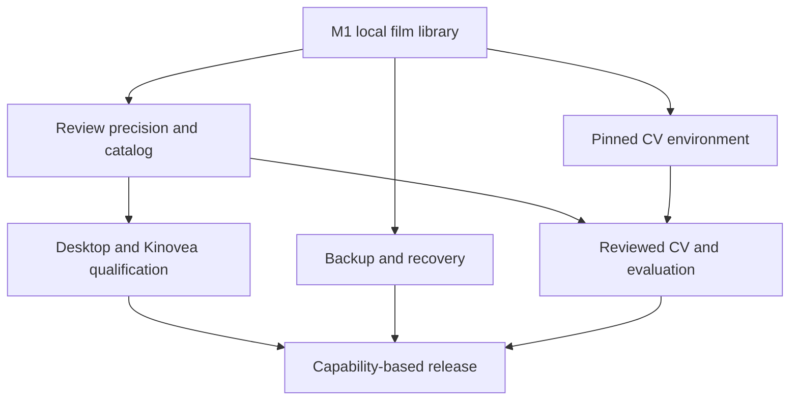

# Implementation roadmap

## First push

The first push is a **complete local film-library candidate**, scoped by EFA-001–016. It connects imports, immutable sources, selected intervals, titles/tags/roster context, notes, retrieval, playlists, exports, the packaged browser UI, and safe optional adapter foundations. It also establishes the full remaining backlog and its GitHub issue mappings.

The status register is [tickets/catalog.json](tickets/catalog.json). Its status and evidence entries govern claims; this roadmap does not independently mark a capability complete. Exact M1 API behavior is in [IMPLEMENTATION_CONTRACT.md](IMPLEMENTATION_CONTRACT.md).

A first-milestone acceptance requires real generated media with audio, an unchanged source hash, persistence across restart, accurate export, useful error states, and installed-package assets. Unit/mocked integration checks can qualify the M1 Kinovea and football-cv boundaries. They cannot stand in for native Windows testing or real-model evaluation.

## Milestone map

| Milestone | Scope | Exit evidence |
| --- | --- | --- |
| **M1 · EFA-001–016** | Useful personal library and safe integration foundations. | Executed API/storage/media checks, complete UI journey, real FFmpeg export, packaging, and explicit unrun native/model gates. |
| **M2 · EFA-017–028** | Faster categorization, alternative cuts, accurate frame study, comparison/annotations, reusable sessions, and deeper KVA mapping. | Review workflows with precise time/coordinate behavior, conflict-safe imports, preserved originals/sidecars, and rendered UI checks. |
| **M3 · EFA-029–039** | Optional reproducible CV, reviewed calibration, supervised jobs, complete artifacts, overlays/corrections/identity, and measured quality. | Pinned environment, actual source-bound runs, audio/timing checks, and a representative local evaluation with uncertainty and failure cases. |
| **M4 · EFA-040–048** | Desktop convenience, backup/restore, interoperability, migration/storage hardening, scale, and release support. | Named platform/version qualification, recovery drill, measured media/library limits, and a capability-specific release matrix. |

Milestones group related outcomes. Work can proceed across groups when the ticket dependencies permit it.

## Recommended sequence after M1

**Protect the accumulating library.** Start [EFA-042 backup/restore](tickets/EFA-042.md) as soon as its M1 dependencies are qualified. Recovery should not wait for a detector project. Migration recovery and storage health follow as their dependencies become available.

**Improve everyday review.** Implement [tag vocabulary](tickets/EFA-017.md), [alternative cuts](tickets/EFA-019.md), and [accurate frame navigation](tickets/EFA-020.md). The owner can retain a wide analysis view and a tight viewing cut, then compare meaningful moments precisely. Batch editing, annotation, saved searches, and sessions build on those foundations.

**Keep both desktop paths explicit.** The macOS launcher supports the browser/media workflow. Windows qualification separately establishes Kinovea launch, sidecar reopening, and comparison behavior. No Apple Silicon Kinovea support is assumed.

**Advance CV through evidence.** Establish [the actual pinned environment](tickets/EFA-029.md), [manual calibration](tickets/EFA-030.md), [preflight context](tickets/EFA-031.md), and [supervised jobs](tickets/EFA-032.md) before promising automatic overlays. Preserve artifacts and review corrections before evaluating quality. Calibration transfer and tracking improvements follow representative evaluation.

## Parallel work boundaries



This diagram shows workstream relationships. The exact dependency graph lives in the catalog and is checked by:

```bash
python docs/tickets/validate.py --show-order
```

For example, EFA-034 overlay rendering depends on EFA-035 reviewed correction semantics even though its numeric ID is lower. Ticket numbers are stable identifiers, not a substitute for dependency resolution.

## What completion means

A ticket begins planned, becomes in_progress while being built, becomes implemented when its candidate and stated acceptance are evidenced, and becomes done after accepted merge. A blocked ticket identifies the missing environment/dependency and the next action. The [ticket index](tickets/README.md) defines the full schema and status rules.

Evidence should identify the tested code revision, executed commands/workflow, runtime/platform, result, and material limits. A final handoff must separately identify:

- Browser/library behavior.
- Media decoding/encoding and audio preservation.
- Native Kinovea behavior by tested Windows/release combination.
- Optional detector environment and measured footage profile.
- Backup/restore and migration qualification.

A release can honestly support the core film room while an optional analysis capability remains experimental or unrun. It cannot describe every future ticket as shipped merely because the backlog and adapter skeleton exist.
